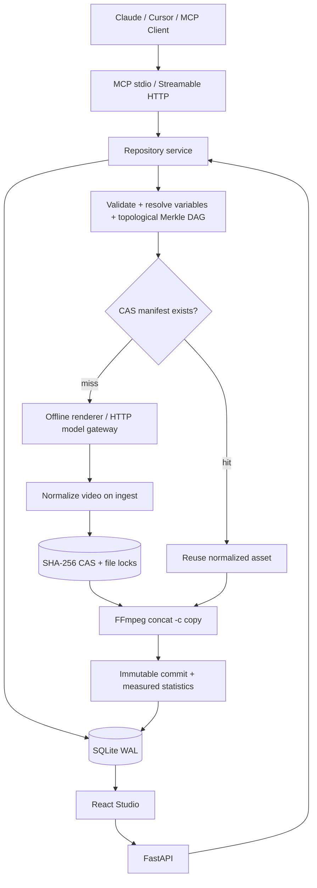

# 架构与数据约束

## 工作流身份

节点键为 SHA-256(canonical JSON(tool, resolved prompt, params, ordered upstream hashes, provider fingerprint, normalization profile))。只有实际引用的变量进入提示词。节点标题和未引用变量属于编辑元数据，不会触发媒体重算；修改上游会递归传播到所有下游。节点列表顺序决定最终分镜顺序，依赖拓扑只决定生成顺序。

## 持久化与并发

仓库保存分支指针、当前分支、各分支草稿和单调递增 revision。每次草稿写入必须携带旧 revision，冲突返回 409。Commit 持有提交时的不可变工作流快照；后台按拓扑执行节点，逐节点持久化任务进度。

节点使用跨进程文件锁。只有媒体写入成功后才原子发布 JSON manifest；临时工作目录在调用结束时释放。分支更新使用事务并检查 expected_head，如果另一个任务已经推进该分支，完成结果仍保存为不可变提交，任务进入 conflict，用户可从结果创建分支。

回滚生成父指向当前 HEAD 的新提交；不会删除历史。Cherry-pick 复制节点、上游依赖闭包和引用变量，进入草稿后仍需 Commit。引用变量采用来源版本的值，因此其他使用同名变量的节点可能同时失效，Diff 和缓存计划会显示影响。

发布记录固定到具体提交，Fork 创建独立仓库并保留来源/许可证。Fork 不改变媒体哈希，可以共享同一 CAS。付费记录只是本地演示账本。

## 恢复

任务保存 owner_pid。启动时仅将所属进程已退出的 queued/running 任务标记为 error，避免误伤另一个活跃 MCP/Web 进程。成功写入的媒体可在下次 Commit 中复用。当前版本不自动恢复未完成的云端任务。

## 已知范围

1. 单机单用户，不开放公网；多用户身份、授权、云 CAS 与分布式队列不在此版本范围。
2. MCP 网关只能记录经由它调用的工具，无法自动监听其他独立 MCP 服务。
3. 离线变量蒸馏是重复短语检测与显式精确替换。LLM 语义抽取可以通过后续模型工具接入。
4. 离线绘图不保证遵循任意提示词语义；它用内容哈希保持确定性，提供可验证的版本与媒体闭环。
5. 外部服务协议经可信 HTTP 网关适配，未配置商业模型或真实支付账户。
6. 原文路线图的外部提交、云上线、比赛视频录制和真实商业化依赖比赛要求与用户账户，本地版本提供路演讲稿与可播放备份成片。
